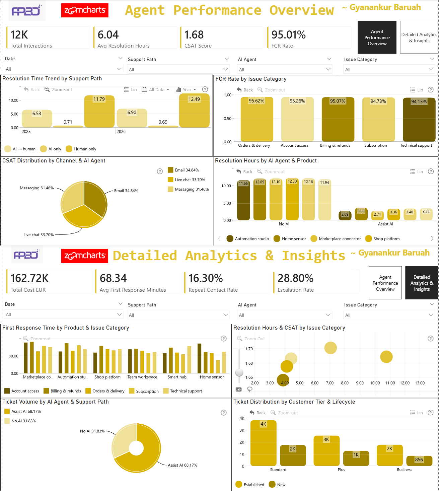

# AI Agents Customer Support Analytics Dashboard

A comprehensive Power BI dashboard for analyzing AI agent performance in customer support operations, tracking efficiency metrics, and identifying optimization opportunities.

## Overview

This dashboard provides end-to-end visibility into AI-powered customer support operations, enabling data-driven optimization of resolution times, customer satisfaction, cost efficiency, and operational performance across multiple support channels and AI agent configurations.

## Dashboard Structure

### Single Page Dashboard with 8 KPI Cards

**Key Performance Indicators:**
- Total Tickets
- Avg Resolution Hours
- CSAT Score
- FCR Rate
- Total Cost EUR
- Avg First Response Minutes
- Repeat Contact Rate
- Escalation Rate

### 8 Interactive Visualizations

1. **Resolution Time Trend by Support Path** - Temporal analysis of resolution performance across AI-only, AI→human, and human-only support paths
2. **FCR Rate by Issue Category** - Identifies issue types with highest first-contact resolution success
3. **CSAT Distribution by Channel & AI Agent** - Channel performance breakdown (Live Chat, Email) with AI agent attribution
4. **Resolution Hours by AI Agent & Product** - Product-specific performance analysis by AI agent type
5. **First Response Time by Product & Issue Category** - Matrix visualization identifying response time bottlenecks
6. **Resolution Hours & CSAT by Issue Category** - Combo chart correlating resolution time with customer satisfaction
7. **Ticket Volume by AI Agent & Support Path** - Treemap showing workload distribution across support routes
8. **Ticket Distribution by Customer Tier & Lifecycle** - Customer segment analysis for strategic insights

## Dashboard Screenshot



## Key Features

- Interactive slicers for filtering by Date Range, Agent Type, Issue Category, and Performance Tier
- Dynamic performance tier coloring (High/Medium/Low) for quick identification
- ZoomCharts integration for advanced network and time-series visualizations
- Cross-filtering between all visuals for drill-down analysis
- Comprehensive tooltips with interaction details
- Bookmark views for different scenarios (Top Performers, Needs Improvement, High Volume)

## Data Model

### Fact Table
- FactSupportTicketsTable: Individual ticket records with complete lifecycle metrics (23 columns)

### Dimension Tables
- DimDate: Date calendar with Year, Quarter, Month, Day attributes
- DimIssue: Issue categorization (Category, Subcategory, SupportTeam)
- DimCustomerProfile: Customer segmentation (Region, Country, Language, CustomerTier, Lifecycle)
- DimProduct: Product information (ProductFamily, ProductName)
- DimSupportRoute: Support path configuration (Channel, SupportPath, AIAgent, PathColor)

## Key Metrics

### Performance Metrics
- Total Tickets volume
- Average Resolution Hours
- CSAT Score (1-5 scale)
- FCR Rate (First Contact Resolution)
- Average First Response Minutes

### Efficiency Metrics
- Total Cost EUR (AI + Human + Repeat costs)
- Repeat Contact Rate
- Escalation Rate
- Average AI Handling Minutes
- Average Human Handling Minutes
- Average Queue Minutes

### Quality Metrics
- SLA Met Rate
- Performance Tier classification (High/Medium/Low/Unknown)

## Technology Stack

- Power BI Desktop
- Power BI Service
- ZoomCharts Custom Visuals (Network Graph, Time Series, Sunburst)
- DAX for calculations and measures

## Installation

### Prerequisites
- Power BI Desktop (latest version)
- Power BI Service account (for publishing and sharing)
- ZoomCharts custom visuals (from AppSource)

### Setup Instructions

1. Clone this repository
2. Download the dataset from the `data/` folder
3. Open the Power BI report file in Power BI Desktop
4. Apply the custom theme: `docs/AI_Agents_Dashboard_Theme.json`
5. Configure data refresh in Power BI Service
6. Publish to your workspace

### Theme Application

To apply the custom theme:
1. Open Power BI Desktop
2. Go to View -> Themes
3. Browse and select `docs/AI_Agents_Dashboard_Theme.json`

## Data Source

The dashboard uses the following Excel file:
- `data/AI_Agents_Customer_Support_Challenge_clean.xlsx`

## DAX Measures

Key measures include:
- Total Tickets
- Avg Resolution Hours
- CSAT Score
- FCR Count & FCR Rate
- Escalation Count & Escalation Rate
- Repeat Contact Count & Repeat Contact Rate
- SLA Met Count & SLA Met Rate
- Total AI Cost EUR
- Total Human Cost EUR
- Total Repeat Cost EUR
- Total Cost EUR
- Avg First Response Minutes
- Avg AI Handling Minutes
- Avg Human Handling Minutes
- Avg Queue Minutes

All measures follow Power BI best practices with DIVIDE function alternative values, proper CALCULATE filter context, and NULL value handling.

See `docs/PowerBI_Dashboard_Specification.md` for complete DAX formulas.

## File Structure

```
.
├── AI Agents Customer Support Analytics Dashboard.pbix          # Power BI report
├── README.md                                                   # This file
├── convert_to_html.py                                          # HTML conversion script
├── data/
│   └── AI_Agents_Customer_Support_Challenge_clean.xlsx        # Source data
├── docs/
│   ├── AI_Agents_Dashboard_Theme.json                         # Custom theme
│   ├── PowerBI_Dashboard_Specification.md                      # Detailed specs
│   ├── PowerBI_Dashboard_Specification.html                    # HTML version of specs
│   └── What ZoomCharts visuals to use in Power BI.pdf          # ZoomCharts guide
├── images/
│   ├── Merged_Dashboard.png                                    # Complete dashboard screenshot
│   ├── Screenshot 2026-11-11 044344.png                        # Dashboard page 1
│   └── Screenshot 2026-11-11 044417.png                        # Dashboard page 2
└── posts/
    ├── fp20_group_post.md                                      # FP20 group submission post
    └── normal_project_post.md                                 # General project post
```

## Usage

### Filtering
Use the slicers on the left sidebar to filter data by:
- Date Range (daily, weekly, monthly)
- Agent Type (Rule-based, ML-based, Hybrid)
- Issue Category (Technical, Billing, General, etc.)
- Performance Tier (High, Medium, Low)

### Navigation
- Use page tabs to switch between Performance Overview and Detailed Analytics
- Click on any visual to cross-filter other visuals
- Use bookmarks for quick access to filtered views

### Drill-down
- Click on issue categories in the treemap to see specific agents
- Click on agent types in the sunburst to see performance details
- Hover over scatter plot points for interaction-specific metrics

## Customization

### Adding New Measures
1. Go to Data view
2. Select the FactAgentInteractions table
3. Click "New Measure" in the ribbon
4. Write your DAX formula
5. Use the measure in visuals

### Modifying Colors
Edit `docs/AI_Agents_Dashboard_Theme.json` to customize:
- Data colors (purple/teal gradient theme)
- Background colors
- Font styles (currently set to bold)
- Visual-specific styling

### Adding New Visuals
Refer to `docs/PowerBI_Dashboard_Specification.md` for:
- Visual type recommendations
- Data field mappings
- ZoomCharts configuration

## Refresh Schedule

Configure scheduled refresh in Power BI Service:
- Dataset refresh: Daily or weekly (depending on data update frequency)
- Gateway setup required for on-premises Excel sources

## Contributors

- Gyanankur Baruah

## License

This project is for educational and demonstration purposes.

## Contact

For questions or feedback, please open an issue in the repository.

## Future Enhancements

- Real-time data integration via API
- Predictive analytics for agent performance
- Automated alert notifications for performance degradation
- Mobile-optimized report layout
- Natural language Q&A integration
- Sentiment analysis integration
