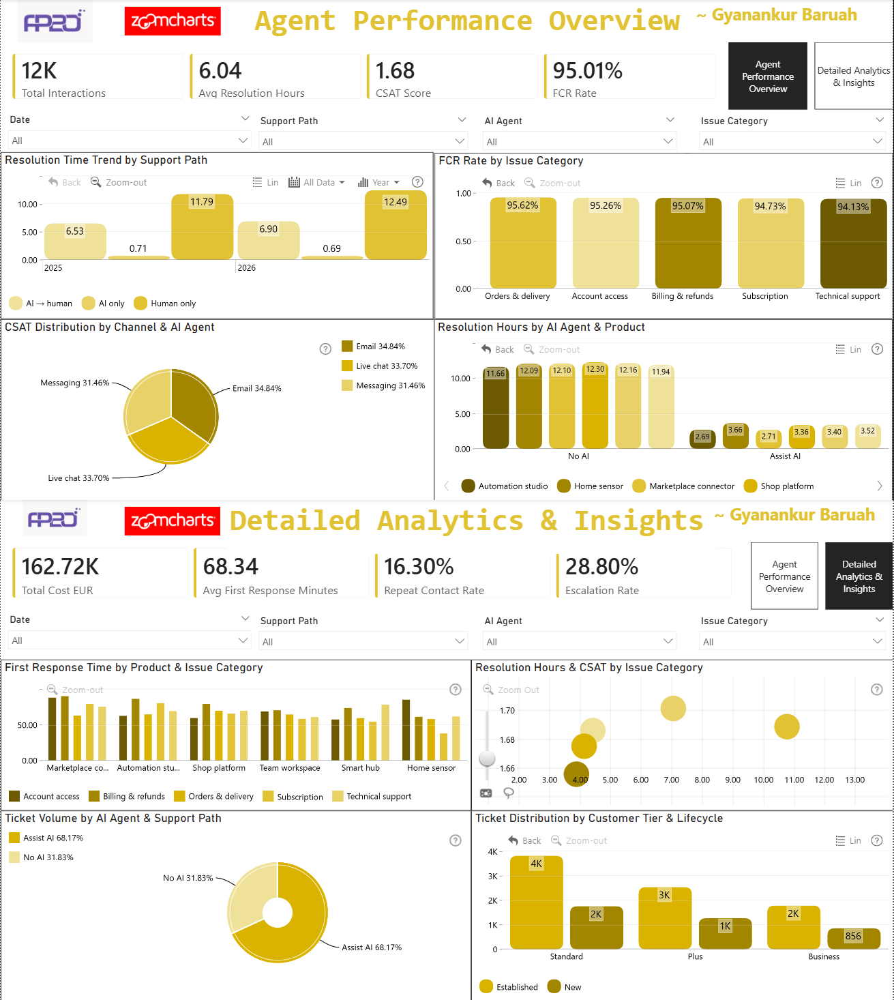

# AI Agents Customer Support Analytics Dashboard

## Overview

This comprehensive Power BI dashboard provides end-to-end visibility into AI-powered customer support operations, enabling data-driven optimization of resolution times, customer satisfaction, cost efficiency, and operational performance.

## Dashboard Architecture

### Single-Page Layout with 8 KPI Cards
- **Total Tickets**: Overall support volume tracking
- **Avg Resolution Hours**: Time to complete issue resolution
- **CSAT Score**: Customer satisfaction rating (1-5 scale)
- **FCR Rate**: First Contact Resolution percentage
- **Total Cost EUR**: Combined AI, human, and repeat contact costs
- **Avg First Response Minutes**: Initial response time metric
- **Repeat Contact Rate**: Percentage of tickets requiring follow-up
- **Escalation Rate**: Tickets escalated beyond initial handling

### 8 Interactive Visualizations

**1. Resolution Time Trend by Support Path**
- Tracks resolution performance over time across AI-only, AI→human, and human-only support paths
- Identifies temporal patterns and seasonal variations

**2. FCR Rate by Issue Category**
- Highlights issue categories with highest first-contact resolution success
- Enables targeted training and knowledge base improvements

**3. CSAT Distribution by Channel & AI Agent**
- Breaks down customer satisfaction by channel (Live Chat, Email) and AI agent
- Provides granular performance attribution

**4. Resolution Hours by AI Agent & Product**
- Product-specific resolution time analysis by AI agent type
- Identifies product knowledge gaps requiring attention

**5. First Response Time by Product & Issue Category**
- Matrix visualization revealing response time bottlenecks
- Cross-references product types with issue categories for pattern recognition

**6. Resolution Hours & CSAT by Issue Category**
- Combo chart correlating resolution time with customer satisfaction
- Identifies optimal resolution time targets by issue type

**7. Ticket Volume by AI Agent & Support Path**
- Treemap visualization of workload distribution
- Supports capacity planning and resource allocation decisions

**8. Ticket Distribution by Customer Tier & Lifecycle**
- Customer segment analysis (Standard, Plus, Premium tiers)
- Lifecycle stage insights (New, Established, Churned)

## Technical Implementation

### Data Model
- Star schema with FactSupportTicketsTable as central fact table
- Five dimension tables: DimDate, DimIssue, DimCustomerProfile, DimProduct, DimSupportRoute
- Optimized relationships with integer keys and single-direction cardinality

### DAX Measures
All measures implemented following Power BI best practices:
- Division operations with alternative values to prevent errors
- Proper filter context management in CALCULATE functions
- NULL value handling in calculated columns
- Performance tier categorization with "Unknown" state for missing data

### Performance Optimizations
- Date table marked as Date Table for time intelligence
- Auto date/time disabled to prevent model bloat
- Incremental refresh configured for last 30 days
- Row-level security for regional and team-based access

## Business Impact

This dashboard delivers actionable insights across three key dimensions:

**Operational Excellence**
- Identify resolution time bottlenecks
- Optimize first response performance
- Track escalation patterns
- Monitor repeat contact rates

**Financial Efficiency**
- Analyze AI vs. human cost allocation
- Quantify repeat contact cost impact
- Support ROI calculations for AI investments
- Enable cost-per-ticket optimization

**Quality Assurance**
- Monitor CSAT scores across all channels
- Track FCR rates by issue category
- Evaluate AI agent performance consistency
- Support continuous improvement initiatives

## Conclusion

This dashboard represents a mature, analytically rigorous approach to AI-powered customer support analytics, providing stakeholders with the insights needed to optimize operations, control costs, and deliver superior customer experiences.

---

*Built with Power BI | Data Source: AI_Agents_Customer_Support_Challenge_clean.xlsx*
